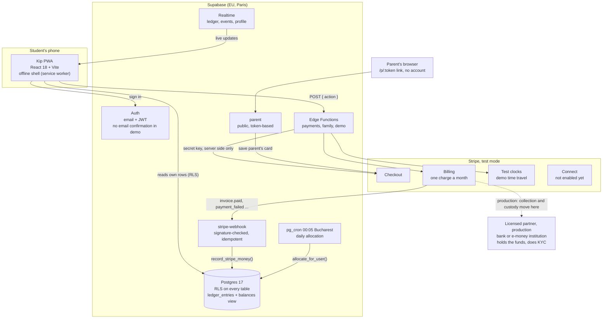

# Kip architecture

Kip is a phone-first web app (installable PWA) that helps Romanian students save towards a goal a little every day. The money side runs on Supabase (Postgres, Auth, Edge Functions, cron) and a Stripe sandbox (test mode). Nothing here moves real money: the demo shows the full flow on Stripe's sandbox, and in production the funds would sit with a licensed partner, not with Kip.

## System

The browser only ever has the public Supabase key. Every money movement goes through an Edge Function that holds the Stripe secret, and Stripe money enters the database only through the webhook.

## Money flow, step by step

1. **Plan.** The student picks a daily amount (5 to 50 lei) and a payday (day 1 to 28). The app talks in lei per day because in a field study that framing got 29.9% of people to sign up against 7.1% for the same money per month (Hershfield, Shu and Benartzi 2020).
2. **Batched top-up.** `payments.start` opens Stripe Checkout for a subscription: the first payment covers only the days until payday, then one charge a month on payday (daily amount x 30). One card charge a month instead of thirty: at 15 lei a day that is 7.75 lei of card fees a month (1.7%) instead of 36.75 lei (8.2%). Checkout lists the product under the Kip name ("Kip: depunerea lunară") and, once paid, sends the student back to the address they started from. Extra deposits ride on the next invoice for no extra fee, or charge now if the student wants.
3. **Webhook to ledger.** Stripe calls `stripe-webhook` with `invoice.paid`. The function checks the signature, stores the event id in `stripe_events` (a replay does nothing), re-fetches the invoice through the pinned SDK and writes a `topup` row into the `de_pus_deoparte` ("to set aside") bucket: pending, then confirmed.
4. **Daily allocation.** Every night at 00:05 Bucharest time `pg_cron` runs `allocate_for_user`, which moves one day's amount from the pot into the primary goal (two ledger rows that net to zero). It runs once per user per day (unique index) under a per-user lock, so the cron, the webhook and the demo can't double-allocate. Milestones (15%, 30% ... 100%) are emitted from SQL right after.
5. **Parent match.** A parent opens a link the student sends, saves a card in Checkout (setup mode) and picks a ratio (1:4 to 4:1) and a monthly cap. On each paid student invoice the webhook charges the parent's card off-session for amount x ratio, capped, skipped under 2 lei, with one idempotency key per invoice. Matched money is flagged `is_matched` and can never be withdrawn by the student.
6. **Withdrawals.** The student can take out their own money at any time (no lock-in: Romanians trust banks least in the region, per the OeNB Euro Survey). `withdraw_own()` runs under a per-user lock, takes from the pot first, then the goal, and refuses anything above own non-matched money. In the sandbox the payout is simulated (ledger rows only). Before impulse spending the app offers a 48-hour cool-off, "Dorm pe idee" ("let me sleep on it"): if the student no longer wants the thing after two days, its price becomes savings. It is opt-in; the backend never delays a withdrawal.

## Key engineering decisions

| Decision | Why |
|---|---|
| **The webhook is the only writer of Stripe money.** Every event id goes into `stripe_events` first; money writes go through `record_stripe_money`, keyed by (Stripe object, type). | Stripe retries and replays events. A replay can't double count, a late "failed" never downgrades a confirmed payment, and a modified client can't fake a top-up. |
| **Integer bani everywhere** (`bigint`, CHECK constraints), balances are a view that sums confirmed ledger rows. | No floating-point rounding. Every balance can be recomputed and audited from the ledger. Pending and failed rows are shown but never counted. |
| **RLS on every table.** Students read only their own rows; the only money row they may write is a self-reported `manual_record`; `stripe_events` has no policies (server only). | A leaked public key or a tampered app still can't read someone else's data or move money. Verified on the deployed project: RLS is on for all 7 public tables. |
| **Dates are Europe/Bucharest.** Amounts are tied to `YYYY-MM-DD` in Bucharest; the cron runs at 22:05 UTC (00:05 EET). | "Today" has to be the student's day, not the server's. pg_cron is UTC-only, so the schedule moves an hour at the end of March (documented). |
| **Allocation is idempotent and serialized** (unique index per user and day, advisory lock per user). | Three writers (cron, webhook, demo) can touch the same user at the same time. |
| **First payment as a Checkout "trial" plus a one-time line.** | Stripe refuses `proration_behavior: none` with one-time prices and its own pro-rata stub was off by about 15 lei. This gives exact amounts, verified in the sandbox. |
| **Stripe SDK and API version pinned**; handlers re-fetch invoices and subscriptions instead of trusting event payloads. | Events arrive rendered in the account's newer API version; re-fetching keeps one shape. |
| **Checkout returns to the caller's Origin**, from an allowlist: `appUrl(req)` in `supabase/functions/_shared/env.ts` uses the request's `Origin` when it is the configured `APP_URL`, localhost or a `*.vercel.app` preview, and `APP_URL` otherwise. Parent links are built the same way. | The same backend serves dev ports, Vercel previews and the live site, and Stripe rejects anything but a full URL (`url_invalid`), so one fixed `APP_URL` could not cover them. The allowlist stops a forged `Origin` from sending a student to someone else's site after paying. |
| **One Stripe test clock per demo student.** `demo.advance_month` moves the clock a month, waits for the renewal webhook, then allocates the skipped days. | Judges see a month of renewals, a declined card and its recovery in about 20 seconds, through the real webhook path, not a mock. |

## Real vs simulated in the demo

| Part | In the demo | In production |
|---|---|---|
| "Încearcă cu date demo" button | A sample account with eight weeks of simulated history, stored only in this browser. Works offline, no backend needed. | Same, as a try-before-sign-up mode. |
| Sign-up, goals, ledger, balances | Real: Supabase Auth and Postgres on project `nexxt` (EU), RLS enforced (app branch `feat/real-money`). Email confirmation is off for the demo (`mailer_autoconfirm`), so a new account reaches Checkout at once. | Same, with email confirmation on and identity checked by the partner's KYC. |
| Card payments, subscriptions, parent card | Real Stripe API calls in a **sandbox** (test mode). The app shows no "test mode" label, so pay with test card 4242 4242 4242 4242, any future expiry, any CVC. No real money. | Live mode, collected by or through the licensed partner. |
| Webhooks, idempotency, daily cron | Real, running on the deployed Edge Functions and pg_cron. | Same. |
| Time | Stripe test clocks and `profiles.sim_date` fast-forward months. | Real calendar. |
| Where the money sits | On the Stripe test platform balance (Connect is not enabled, so no per-student account yet). | With a licensed bank or e-money partner, in the student's name. |
| Withdrawals | Ledger rows marked "plată simulată în sandbox". | Payout from the partner to the student's own IBAN. |
| Bank account data | None. | Read-only open banking through a licensed aggregator (stage 2). |
| Notifications | In-app banners and events. | Same, plus at most one push a week. |

More detail: [assumptions and limits](assumptions-and-limits.md), [audit](audit.md), backend API contract in `supabase/CONTRACT.md` and decision log in `docs/decisions.md` on the `feat/avansul` branch.
